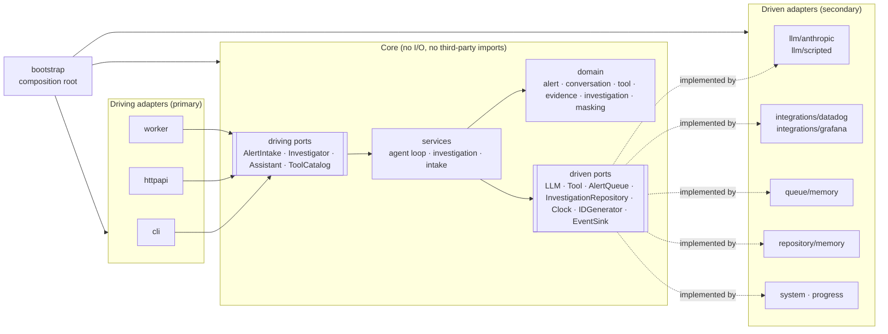

# OpenSRE in Go: hexagonal architecture

This module re-implements OpenSRE as a Go service using a hexagonal
(ports-and-adapters) architecture. It runs next to the Python implementation
during migration and keeps the same environment variables and HTTP contract
(`POST /alerts`, `POST /v1/prompt`, `GET /healthz`), so you can move traffic
one endpoint at a time.

## The hexagon



## Layout

```
go/
├── cmd/opensre/            entrypoint: load config, bootstrap, run the CLI
└── internal/
    ├── core/
    │   ├── domain/         entities and pure rules (stdlib only)
    │   ├── ports/          driven.go (core → outside), driving.go (outside → core)
    │   └── services/       use cases: agent (ReAct loop), investigation, intake
    ├── adapters/
    │   ├── primary/        cli, httpapi, worker: they call driving ports
    │   └── secondary/      llm, integrations, queue, repository, system, progress
    ├── bootstrap/          composition root: the only package that knows every adapter
    ├── platform/config/    environment variables
    └── archtest/           enforces the dependency rules below
```

## Dependency rules

`internal/archtest` checks these on every `go test ./...`. They are the Go
counterpart of the Python repo's import-linter contracts.

| Package | May import (first-party) | Third-party |
| --- | --- | --- |
| `core/domain` | other `core/domain` packages | no |
| `core/ports` | `core/domain` | no |
| `core/services` | `core/domain`, `core/ports`, other services | no |
| `adapters/primary` | `core/domain`, `core/ports` | no |
| `adapters/secondary` | `core/domain`, `core/ports` | yes (SDKs live only here) |
| `platform` | nothing | no |
| `bootstrap`, `cmd` | anything | yes |

The rules apply to production code only. Tests may wire real adapters together.

## Mapping from the Python packages

| Python | Go | Notes |
| --- | --- | --- |
| `core/agent/react_loop.py` | `core/services/agent` | Iteration cap, stagnation fingerprinting, safety handoff with tools disabled, overflow retry with a smaller budget, parallel execution of concurrency-safe tools |
| `core/context_budget.py` | `services/agent/budget.go` | Character estimate; elides the oldest tool results first and always keeps the latest batch |
| `core/tool/contracts.py`, `tool_framework` | `core/domain/tool` + `ports.Tool` | The `@tool` decorator metadata becomes `tool.Spec`. The per-tool `evidence_mapper` becomes `tool.Output.Evidence` |
| `core/tool/registry.py` | `services/agent/registry.go` | Specs come out sorted, so the tool list stays byte-stable for prompt caching |
| `core/domain/types/evidence.py` | `core/domain/evidence` | `E1…En` citation ids |
| `core/domain/alerts/inbox.py` | `ports.AlertQueue` + `secondary/queue/memory` | Bounded queue; when full, drops the oldest alert |
| `infrastructure/alert_intake.py` | `primary/httpapi` + `services/intake` | Same trust boundary: a bearer token (compared in constant time), or a loopback caller that is not a browser |
| `infrastructure/safety/masking` | `core/domain/masking` | Secret redaction on tool output before the model sees it |
| `core/llm/providers/*` | `secondary/llm/<provider>` | Anthropic adapter on the official SDK; the scripted adapter backs tests |
| `integrations/<vendor>/client.py` + `tools/` | `secondary/integrations/<vendor>` | Each vendor exposes `Tools(client) []ports.Tool` |
| `surfaces/cli` | `primary/cli` | |
| `surfaces/shared/process_boot.py`, `CAPABILITY_REGISTRARS` | `bootstrap` | Integrations register only when their credentials are set |
| `config/constants` | `platform/config` | Same env var names |

## A request through the hexagon

1. `POST /alerts` (httpapi) checks the token or loopback rule, caps the body at
   1 MiB, and calls `AlertIntake.Accept`.
2. `intake.Service` normalizes and validates the alert, stamps `ReceivedAt`,
   and enqueues it through `ports.AlertQueue`.
3. `worker` dequeues it and calls `Investigator.Investigate`.
4. `investigation.Service` creates the `Investigation` aggregate
   (pending → running), saves it, and runs `agent.Runner`.
5. The runner calls `ports.LLM`. For each tool call it validates the input
   against `tool.Schema`, invokes the `ports.Tool` under a timeout, masks the
   output, and records its evidence.
6. The aggregate moves to completed or failed and is saved. `GET /investigations/{id}`
   reads it back.

## Design decisions

- **The core owns the agent loop.** The LLM port handles one turn only
  (`Complete`), so loop policy (limits, stagnation, budget, concurrency) is
  provider-agnostic and tested with the scripted adapter.
- **Opaque replay state.** `conversation.Message.Native` carries the
  provider's own copy of an assistant turn. The Anthropic adapter uses it to
  replay thinking blocks unchanged, which current Claude models require. The
  core never reads it.
- **A tool failure is an observation, not a run failure.** Unknown tools,
  schema violations, errors, and panics all go back to the model as
  `is_error` results. Validation messages name fields, never the values the
  model sent.
- **Errors are redacted at the HTTP boundary.** Full detail goes to `slog`.
  External callers get `internal error`, and a failed investigation stores a
  generic reason.
- **Claude defaults.** The default model is `claude-opus-5-5` at effort `high`.
  Server-side refusal fallbacks (`fallbacks: "default"`) are on; set
  `OPENSRE_DISABLE_LLM_FALLBACKS=1` to turn them off.

## Known limits of this slice

- Storage is in memory: investigations are lost on restart.
- Mutating tools have no approval gate yet, and every shipped tool is
  read-only. Add the `ApprovalGate` port (below) before registering any
  non-read-only tool.
- Eliding old tool results edits history. Claude may then drop the thinking
  blocks after that point. This only happens once a run outgrows its budget.
- No streaming output.

## Migration roadmap

The dated 4-week plan with task checklists is in [ROADMAP.md](ROADMAP.md).
In outline, each step adds adapters (and, where needed, a port). Steps 1–4 leave the core
unchanged.

1. **More integrations:** port each `integrations/<vendor>` as
   `secondary/integrations/<vendor>`: Datadog events, Grafana
   metrics/traces/alert rules, then CloudWatch, Kubernetes, PagerDuty, Sentry,
   GitHub, and the rest.
2. **More LLM providers:** OpenAI, Bedrock, Vertex, and Ollama as
   `secondary/llm/<provider>`, chosen in `bootstrap` by `LLM_PROVIDER`.
3. **Durable storage:** `secondary/repository/postgres` (and SQLite for local
   use) implementing `InvestigationRepository`, with migrations.
4. **Observability:** OpenTelemetry and Sentry `EventSink` adapters.
5. **Guardrails:** a domain policy plus an `ApprovalGate` port, checked by the
   runner before any non-read-only tool runs.
6. **Chat gateway:** `primary/chat/{slack,telegram,discord}` and a
   `SessionRepository` port for multi-turn conversations.
7. **Scheduler and REPL:** a `primary/scheduler` driving adapter and an
   interactive `primary/repl`.
8. **Skills and prompts:** a `SkillSource` port that reads the existing
   human-owned `SKILL.md` files and prompts as they are. They stay owned and
   edited by humans.
